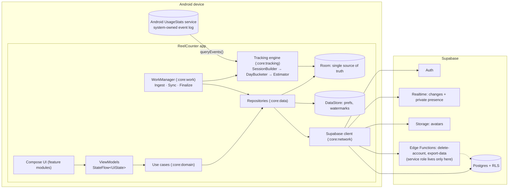
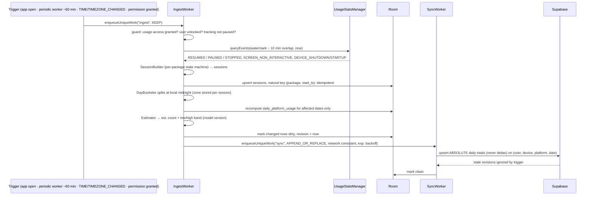
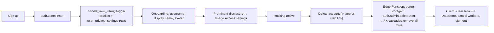

# 01: System Architecture & Data Flow

Phase 1 deliverable. Read this together with [02 feasibility](02-platform-feasibility.md) (why the data sources are what they are) and [03 schema](03-database-schema.md).

## 1. Architecture diagram



### Client stack

| Concern | Choice |
|---|---|
| Language / UI | Kotlin 2.x, Jetpack Compose, Material 3 (dynamic color) |
| Architecture | Clean Architecture, MVVM, Repository pattern; unidirectional data flow (`StateFlow<UiState>`) |
| DI | Hilt |
| Async | Kotlin Coroutines + Flow |
| Local data | Room (single source of truth for the user's own data), DataStore (preferences, watermarks) |
| Background | WorkManager (no foreground service) |
| Backend client | supabase-kt (Auth, Postgrest, Realtime, Storage, Functions) on the Ktor OkHttp engine; kotlinx.serialization |
| Images / charts | Coil 3; Vico (Compose-native charts, Phase 7) |
| SDK levels | minSdk 26, targetSdk 36. Play currently requires targetSdk 36; re-check at release. |

### Module layout (proposal; Phase 2 finalizes it)

```
:app                     Application, MainActivity, NavHost, DI root
:build-logic             Gradle convention plugins
:core:model              Pure Kotlin domain models (Platform, MetricQuality, DailySummary, …)
:core:domain             Use cases + repository interfaces (pure Kotlin, no Android)
:core:data               Repository implementations, sync orchestration
:core:database           Room entities, DAOs, migrations
:core:datastore          DataStore (settings, ingest watermark, tracking-paused flag)
:core:network            Supabase client wrapper, DTOs, mappers
:core:tracking           UsageStats data source, SessionBuilder, DayBucketer, Estimator
:core:work               Workers + scheduling
:core:designsystem       M3 theme, tokens, base components
:core:ui                 Shared screen-level composables, Loading/Empty/Error/Offline wrappers
:core:testing            Fakes, test rules, fixed clocks
:feature:auth            :feature:onboarding (disclosure, permission, app selection)
:feature:today           :feature:insights (weekly / monthly)
:feature:friends         :feature:leaderboard
:feature:profile         :feature:settings (privacy, export, delete)
```

- Each feature module holds `ui/` and `presentation/` packages; domain and data stay in core.
- Dependencies only point inward: feature → domain ← data. `:core:domain` and `:core:model` have no Android dependencies, so the tracking and estimation logic is testable on the JVM.

### Backend stack

| Service | Use |
|---|---|
| Supabase Auth | Email/password; PKCE deep link for password reset; session persisted on device |
| Postgres | All app tables; RLS enabled on every table, deny by default |
| Realtime | `postgres_changes` for friend-request updates; Presence on **private** channels with Realtime Authorization (friends only, opt-in) |
| Storage | `avatars/{uid}/…` bucket, writable only by the owning user |
| Edge Functions | `delete-account`, `export-data` and, post-v1, the data-portability connectors. **The only place the service-role key exists.** |

## 2. Data flows

### 2a. Tracking ingestion (on device, pull-based)

The design rests on one fact: Android already records foreground events in a system-owned log. The app doesn't need to run all the time. It only needs to read that log often enough, before the events expire (see L2 in [04](04-technical-limitations.md)).



#### SessionBuilder rules

The SessionBuilder runs one state machine per tracked package:
- **Open** a session on `ACTIVITY_RESUMED`.
- **Close** it on whichever comes first:
  - `ACTIVITY_PAUSED` or `ACTIVITY_STOPPED` for that package
  - `SCREEN_NON_INTERACTIVE`
  - `DEVICE_SHUTDOWN`
  - `ACTIVITY_RESUMED` of a different package (single-window case)
- **If the session is still open at read time** and the app is in the foreground, end it provisionally at `now` and flag it `is_open`. The next run recomputes it.
- **If it was open across a reboot**, close it at the last trustworthy event before `DEVICE_STARTUP`.
- **Drop sessions shorter than `min_session_sec`**, which come from accidental opens.

#### Invariants

- **Duplicate prevention:**
  - Sessions are keyed by `(package, start_ts)`.
  - Each run recomputes whole affected days.
  - Sync sends absolute values under a unique key.
  - A monotonic `revision` decides conflicts.
  - Together these make every retry, double-run or overlapping window safe.
- **Finalization:** once a day is older than D−2 and fully covered, it is frozen (`is_final = true`). We never recompute it from OS events again, because the OS deletes old events and a recompute would shrink the totals.
- **Gaps:**
  - If no ingest ever covered part of a day, that part is reported as UNAVAILABLE (a "tracking gap"), **never as 0**.
  - A per-day coverage watermark keeps "no usage" and "no data" apart.
- **Midnight rollover:**
  - Sessions are split at the local-midnight boundary.
  - The UI's `CurrentDateProvider` flow ticks at local midnight and on `ACTION_DATE_CHANGED` and `ACTION_TIMEZONE_CHANGED`.
  - We need no alarms.
- **Reboot:**
  - WorkManager reschedules its own work after a reboot, so we declare no `BOOT_COMPLETED` receiver of our own.
  - Sessions close at `DEVICE_SHUTDOWN`.
- **Pause / stealth:**
  - **Pause** stops ingest. Paused intervals are recorded as UNAVAILABLE ("paused").
  - **Stealth** keeps tracking locally but hides activity and presence from everyone on the server, and it doesn't reveal that stealth is on.

### 2b. Sync & conflict resolution

| Concern | Rule |
|---|---|
| Payload | Absolute per-day totals per (user, device, platform, date). Deltas are never sent. |
| Idempotency | Unique key `(user_id, device_id, platform_id, activity_date)` + upsert |
| Conflicts | Client-monotonic `revision`; a server `BEFORE UPDATE` trigger drops writes with `revision <= stored revision` |
| Multi-device | One row per device; the `daily_activity_totals` view sums devices |
| Retry | WorkManager exponential backoff; network constraint; unique work name, so syncs never run in parallel |
| Trust boundary | Clients can't write `VERIFIED` or `source = 'data_portability'`; RLS enforces this |

### 2c. Social read path

1. The friends and leaderboard screens query `daily_activity_summaries` / `daily_activity_totals` through PostgREST.
2. **RLS filters rows on the server.** The client never filters for privacy; it can only see what the database lets it see.
3. Results are cached in Room with `fetched_at` so the screens work offline (marked "last updated …").
4. Realtime `postgres_changes` pushes friend-request changes to both parties.
5. Presence is opt-in (`share_presence`), and only accepted, non-blocked friends can see it.

### 2d. Account lifecycle (detailed in Phase 3 and Phase 8)


