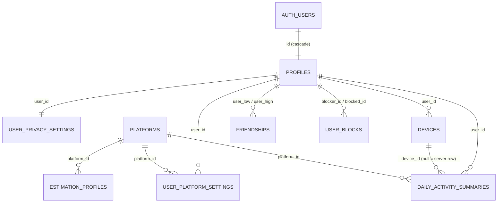

# 03: Database Schema Proposal (Supabase Postgres 15+)

Phase 1 deliverable. **This is a proposal, not a migration.**
- Phase 3 turns the identity tables into the first migration under `supabase/migrations/`.
- Phase 5 adds the activity tables, and Phase 6 the social RPCs.
- Phase 9 tests every RLS policy with pgTAP.

## Design principles

1. **Deny by default.** RLS is enabled on every table, and no policy means no access.
2. **No email or other PII outside `auth.users`.** The `profiles` table holds only what a friend may see.
3. **Authorization helpers live in a non-exposed `private` schema**, so PostgREST can't call them as RPCs. Without this, a helper like `are_friends(x, y)` would let anyone probe whether two strangers are friends.
4. Every `SECURITY DEFINER` function uses `set search_path = ''` and fully-qualified names.
5. `auth.uid()` is wrapped as `(select auth.uid())` so Postgres evaluates it once per statement rather than once per row.
6. Every column used in an RLS predicate is indexed.
7. Views use `with (security_invoker = true)`. Without it, a view runs as its owner and **bypasses RLS**.
8. **Clients can never write `VERIFIED` or `source = 'data_portability'`.** Only Edge Functions using the service role can.
9. State transitions with rules (friend requests, blocks) go through RPCs, never through direct table writes.
10. Supabase grants `EXECUTE` on new public functions to `anon` by default, so every RPC revokes it explicitly.

## Entity relationships



## 1. Types and reference data

```sql
create schema if not exists private;          -- NOT added to the API's exposed schemas
grant usage on schema private to authenticated;

create type public.metric_quality    as enum ('VERIFIED','ESTIMATED','DURATION_ONLY','UNAVAILABLE'); -- order = precedence
create type public.visibility_level  as enum ('public','friends','private');
create type public.friendship_status as enum ('pending','accepted');
create type public.activity_source   as enum ('usage_stats','data_portability','manual');

create table public.platforms (
  id               text primary key,                 -- 'tiktok','instagram','youtube','facebook'
  display_name     text not null,
  android_packages text[] not null,
  default_quality  public.metric_quality not null,
  verified_capable boolean not null default false,
  is_active        boolean not null default true,
  sort_order       smallint not null default 0
);

create table public.estimation_profiles (
  platform_id      text not null references public.platforms(id),
  version          int  not null,
  short_form_share numeric(4,3) not null check (short_form_share between 0 and 1),
  share_low        numeric(4,3) not null check (share_low  between 0 and 1),
  share_high       numeric(4,3) not null check (share_high between 0 and 1),
  seconds_per_reel numeric(5,1) not null check (seconds_per_reel > 0),
  seconds_low      numeric(5,1) not null check (seconds_low  > 0),
  seconds_high     numeric(5,1) not null check (seconds_high > 0),
  min_session_sec  int not null default 3,
  published_at     timestamptz not null default now(),
  primary key (platform_id, version),
  check (share_low <= short_form_share and short_form_share <= share_high),
  check (seconds_low <= seconds_per_reel and seconds_per_reel <= seconds_high)
);

-- Seed (platform names are used nominatively; "YouTube" not "YouTube Shorts" because we measure whole-app time)
insert into public.platforms (id, display_name, android_packages, default_quality, verified_capable, sort_order) values
  ('tiktok',    'TikTok',    '{com.zhiliaoapp.musically,com.ss.android.ugc.trill,com.zhiliaoapp.musically.go}', 'ESTIMATED',     true,  1),
  ('instagram', 'Instagram', '{com.instagram.android,com.instagram.lite}',                                        'ESTIMATED',     false, 2),
  ('youtube',   'YouTube',   '{com.google.android.youtube}',                                                      'DURATION_ONLY', true,  3),
  ('facebook',  'Facebook',  '{com.facebook.katana,com.facebook.lite}',                                           'DURATION_ONLY', false, 4);
-- estimation_profiles rows are seeded in Phase 4, after calibration spike S2.
```

## 2. Identity and settings

```sql
create table public.profiles (
  id           uuid primary key references auth.users(id) on delete cascade,
  username     text unique check (username ~ '^[a-z0-9][a-z0-9_.]{1,18}[a-z0-9]$'), -- 3–20 chars, lowercase canonical; NULL until onboarding
  display_name text check (char_length(display_name) <= 50),
  avatar_path  text,
  bio          text check (char_length(bio) <= 160),
  created_at   timestamptz not null default now(),
  updated_at   timestamptz not null default now()
);
create index profiles_username_prefix on public.profiles (username text_pattern_ops);

create table public.user_privacy_settings (
  user_id                uuid primary key references public.profiles(id) on delete cascade,
  profile_visibility     public.visibility_level not null default 'friends',
  activity_visibility    public.visibility_level not null default 'friends',
  discoverable           boolean not null default true,   -- appears in username search
  accept_friend_requests boolean not null default true,
  share_presence         boolean not null default false,  -- online status is opt-in
  stealth_mode           boolean not null default false,  -- hides activity + presence from everyone, silently
  updated_at             timestamptz not null default now()
);

create table public.user_platform_settings (
  user_id                   uuid not null references public.profiles(id) on delete cascade,
  platform_id               text not null references public.platforms(id),
  is_tracked                boolean not null default true,
  visibility                public.visibility_level not null default 'friends', -- effective = stricter of this and activity_visibility
  estimation_enabled        boolean not null default true,
  share_override            numeric(4,3) check (share_override between 0 and 1),
  seconds_per_reel_override numeric(5,1) check (seconds_per_reel_override > 0),
  updated_at                timestamptz not null default now(),
  primary key (user_id, platform_id)
);

create table public.devices (
  id           uuid primary key,           -- random per-install UUID; no hardware identifiers
  user_id      uuid not null references public.profiles(id) on delete cascade,
  label        text check (char_length(label) <= 40),
  app_version  text,
  created_at   timestamptz not null default now(),
  last_sync_at timestamptz
);
create index devices_user on public.devices (user_id);

-- New auth user → profile + default privacy settings
create function private.handle_new_user() returns trigger
language plpgsql security definer set search_path = '' as $$
begin
  insert into public.profiles (id) values (new.id);
  insert into public.user_privacy_settings (user_id) values (new.id);
  return new;
end $$;
create trigger on_auth_user_created after insert on auth.users
  for each row execute function private.handle_new_user();
```

## 3. Activity

```sql
create table public.daily_activity_summaries (
  id                   bigint generated always as identity primary key,
  user_id              uuid not null references public.profiles(id) on delete cascade,
  device_id            uuid references public.devices(id) on delete cascade,  -- NULL = server-sourced (verified) row
  platform_id          text not null references public.platforms(id),
  activity_date        date not null,                 -- user-local calendar date
  tz_id                text not null,                 -- IANA zone used for bucketing
  foreground_ms        bigint not null default 0 check (foreground_ms between 0 and 90000000), -- ≤ 25 h (DST day)
  session_count        int not null default 0 check (session_count >= 0),
  estimated_reels      int check (estimated_reels >= 0),
  estimated_reels_low  int check (estimated_reels_low >= 0),
  estimated_reels_high int check (estimated_reels_high >= 0),
  verified_reels       int check (verified_reels >= 0),
  quality              public.metric_quality not null,
  source               public.activity_source not null,
  estimation_version   int,
  user_adjusted        boolean not null default false,
  is_final             boolean not null default false,
  revision             bigint not null,               -- client-monotonic; stale writes dropped by trigger
  created_at           timestamptz not null default now(),
  updated_at           timestamptz not null default now(),
  constraint daily_uq unique nulls not distinct (user_id, device_id, platform_id, activity_date),
  constraint verified_has_count  check (quality <> 'VERIFIED'  or verified_reels  is not null),
  constraint estimated_has_count check (quality <> 'ESTIMATED' or estimated_reels is not null),
  constraint no_count_when_not_counted check (
    quality not in ('DURATION_ONLY','UNAVAILABLE') or (estimated_reels is null and verified_reels is null)),
  constraint band_ordered check (
    estimated_reels is null or (estimated_reels_low <= estimated_reels and estimated_reels <= estimated_reels_high))
);
create index daily_user_date on public.daily_activity_summaries (user_id, activity_date desc);

-- Key columns immutable; stale revisions silently ignored (makes upsert retries safe).
-- A trigger is used instead of column grants because PostgREST upserts SET every payload column.
create function private.daily_activity_guard() returns trigger
language plpgsql set search_path = '' as $$
begin
  if (new.user_id, new.device_id, new.platform_id, new.activity_date)
     is distinct from (old.user_id, old.device_id, old.platform_id, old.activity_date) then
    raise exception 'daily_activity_summaries key columns are immutable';
  end if;
  if new.revision <= old.revision then
    return null;              -- keep the newer stored row
  end if;
  new.updated_at := now();
  return new;
end $$;
create trigger daily_activity_guard before update on public.daily_activity_summaries
  for each row execute function private.daily_activity_guard();

-- Per-user totals across devices. security_invoker = true → underlying RLS applies to the caller.
create view public.daily_activity_totals with (security_invoker = true) as
select user_id, platform_id, activity_date,
       sum(foreground_ms)        filter (where source <> 'data_portability') as foreground_ms,
       sum(session_count)                                                      as session_count,
       sum(estimated_reels)      filter (where quality = 'ESTIMATED')         as estimated_reels,
       sum(estimated_reels_low)  filter (where quality = 'ESTIMATED')         as estimated_reels_low,
       sum(estimated_reels_high) filter (where quality = 'ESTIMATED')         as estimated_reels_high,
       max(verified_reels)       filter (where quality = 'VERIFIED')          as verified_reels,
       min(quality)                                                            as best_quality,  -- enum order = precedence
       bool_or(user_adjusted)                                                  as user_adjusted
from public.daily_activity_summaries
group by user_id, platform_id, activity_date;
```

## 4. Social graph

```sql
create table public.friendships (                   -- one row per unordered pair
  id           bigint generated always as identity primary key,
  user_low     uuid not null references public.profiles(id) on delete cascade,
  user_high    uuid not null references public.profiles(id) on delete cascade,
  requested_by uuid not null,
  status       public.friendship_status not null default 'pending',
  created_at   timestamptz not null default now(),
  responded_at timestamptz,
  constraint pair_ordered      check (user_low < user_high),
  constraint requester_in_pair check (requested_by in (user_low, user_high)),
  constraint pair_unique       unique (user_low, user_high)
);
create index friendships_high on public.friendships (user_high);
-- Reject / cancel / unfriend = DELETE. With no "rejected" state, nothing leaks to the requester.
-- Phase 6 adds a re-request cooldown (a small request log) to stop request spam.

create table public.user_blocks (
  blocker_id uuid not null references public.profiles(id) on delete cascade,
  blocked_id uuid not null references public.profiles(id) on delete cascade,
  created_at timestamptz not null default now(),
  primary key (blocker_id, blocked_id),
  check (blocker_id <> blocked_id)
);
create index user_blocks_blocked on public.user_blocks (blocked_id);
```

## 5. Authorization helpers (`private` schema)

```sql
create function private.are_friends(a uuid, b uuid) returns boolean
language sql stable security definer set search_path = '' as $$
  select exists (select 1 from public.friendships f
                 where f.user_low = least(a, b) and f.user_high = greatest(a, b)
                   and f.status = 'accepted');
$$;

create function private.is_blocked_between(a uuid, b uuid) returns boolean
language sql stable security definer set search_path = '' as $$
  select exists (select 1 from public.user_blocks ub
                 where (ub.blocker_id = a and ub.blocked_id = b)
                    or (ub.blocker_id = b and ub.blocked_id = a));
$$;

-- Profile card visible: public profile, friend, or pending-request counterpart; never if blocked.
create function private.can_view_profile(owner uuid) returns boolean
language sql stable security definer set search_path = '' as $$
  select (select auth.uid()) is not null
     and not private.is_blocked_between(owner, (select auth.uid()))
     and ( exists (select 1 from public.user_privacy_settings s
                   where s.user_id = owner and s.profile_visibility = 'public')
        or exists (select 1 from public.friendships f
                   where f.user_low  = least(owner, (select auth.uid()))
                     and f.user_high = greatest(owner, (select auth.uid()))) );
$$;

-- Activity row visible: effective visibility = stricter of account-level and platform-level setting.
create function private.can_view_activity(owner uuid, platform text) returns boolean
language sql stable security definer set search_path = '' as $$
  select (select auth.uid()) is not null
     and not private.is_blocked_between(owner, (select auth.uid()))
     and exists (
       select 1
       from public.user_privacy_settings s
       left join public.user_platform_settings p
              on p.user_id = s.user_id and p.platform_id = platform
       where s.user_id = owner
         and not s.stealth_mode
         and ( s.activity_visibility = 'public'
            or (s.activity_visibility = 'friends' and private.are_friends(owner, (select auth.uid()))) )
         and ( coalesce(p.visibility, 'friends') = 'public'
            or (coalesce(p.visibility, 'friends') = 'friends' and private.are_friends(owner, (select auth.uid()))) )
     );
$$;

revoke execute on all functions in schema private from public, anon;
grant  execute on function private.are_friends(uuid, uuid), private.is_blocked_between(uuid, uuid),
                           private.can_view_profile(uuid), private.can_view_activity(uuid, text)
       to authenticated;   -- needed for RLS evaluation; not callable over the API (schema not exposed)
```

## 6. RLS policies

### Policy matrix

| Table | SELECT | INSERT | UPDATE | DELETE |
|---|---|---|---|---|
| `platforms`, `estimation_profiles` | `authenticated`: all rows | – | – | – (migrations or service role only) |
| `profiles` | own row OR `private.can_view_profile(id)` | – (trigger creates it) | own row; **column grants** allow only `username, display_name, avatar_path, bio` | – (Edge Function deletes accounts) |
| `user_privacy_settings` | own row only. Others' settings are read **only inside** helpers, so nobody can see that someone else is in stealth mode. | – (trigger) | own row | – |
| `user_platform_settings` | own | own | own | own |
| `devices` | own | own | own | own |
| `daily_activity_summaries` | own OR `private.can_view_activity(user_id, platform_id)` | own; `quality <> 'VERIFIED'`, `source <> 'data_portability'`, `device_id` owned by caller | same check; key columns immutable (trigger) | own client-sourced rows |
| `friendships` | caller is `user_low` or `user_high` | – | – | – (RPCs only, Phase 6) |
| `user_blocks` | `blocker_id = caller` only; the blocked person can't detect the block | – (RPC) | – | – (RPC) |
| `storage.objects` (bucket `avatars`) | read per D6 | first path segment = caller's uid | same | same |
| `realtime.messages` (presence) | topic `presence:{uid}` if caller may see that user's presence (friend, `share_presence`, not stealth, not blocked) | own topic only | – | – |

### Representative SQL

```sql
alter table public.profiles                 enable row level security;
alter table public.user_privacy_settings    enable row level security;
alter table public.user_platform_settings   enable row level security;
alter table public.devices                  enable row level security;
alter table public.daily_activity_summaries enable row level security;
alter table public.friendships              enable row level security;
alter table public.user_blocks              enable row level security;
alter table public.platforms                enable row level security;
alter table public.estimation_profiles      enable row level security;

-- Reference data
create policy platforms_read on public.platforms for select to authenticated using (true);
create policy estimation_profiles_read on public.estimation_profiles for select to authenticated using (true);

-- Profiles
create policy profiles_select on public.profiles for select to authenticated
  using (id = (select auth.uid()) or private.can_view_profile(id));
create policy profiles_update on public.profiles for update to authenticated
  using (id = (select auth.uid())) with check (id = (select auth.uid()));
revoke update on public.profiles from authenticated;
grant  update (username, display_name, avatar_path, bio) on public.profiles to authenticated;

-- Privacy settings: owner only
create policy privacy_select on public.user_privacy_settings for select to authenticated
  using (user_id = (select auth.uid()));
create policy privacy_update on public.user_privacy_settings for update to authenticated
  using (user_id = (select auth.uid())) with check (user_id = (select auth.uid()));

-- Activity
create policy activity_select on public.daily_activity_summaries for select to authenticated
  using (user_id = (select auth.uid()) or private.can_view_activity(user_id, platform_id));

create policy activity_insert on public.daily_activity_summaries for insert to authenticated
  with check (
    user_id = (select auth.uid())
    and quality <> 'VERIFIED' and source <> 'data_portability'
    and device_id in (select d.id from public.devices d where d.user_id = (select auth.uid()))
  );

create policy activity_update on public.daily_activity_summaries for update to authenticated
  using (user_id = (select auth.uid()) and source <> 'data_portability')
  with check (
    user_id = (select auth.uid())
    and quality <> 'VERIFIED' and source <> 'data_portability'
    and device_id in (select d.id from public.devices d where d.user_id = (select auth.uid()))
  );

create policy activity_delete on public.daily_activity_summaries for delete to authenticated
  using (user_id = (select auth.uid()) and source <> 'data_portability');

-- Friendships / blocks: read-only to participants; all writes via SECURITY DEFINER RPCs (Phase 6)
create policy friendships_select on public.friendships for select to authenticated
  using ((select auth.uid()) in (user_low, user_high));
create policy blocks_select on public.user_blocks for select to authenticated
  using (blocker_id = (select auth.uid()));

-- Avatars (Storage)
create policy avatars_owner_insert on storage.objects for insert to authenticated
  with check (bucket_id = 'avatars' and (storage.foldername(name))[1] = (select auth.uid())::text);
-- …matching UPDATE / DELETE policies.

-- Presence (Realtime Authorization, private channels). private.can_see_presence(topic text)
-- parses 'presence:{uuid}' safely and applies friend + share_presence + stealth + block checks.
create policy presence_read on realtime.messages for select to authenticated
  using (realtime.messages.extension = 'presence' and private.can_see_presence((select realtime.topic())));
create policy presence_track_own on realtime.messages for insert to authenticated
  with check (realtime.messages.extension = 'presence'
              and (select realtime.topic()) = 'presence:' || (select auth.uid())::text);
```

### Username search RPC (exposed; returns only safe columns)

```sql
create function public.search_profiles(prefix text, max_results int default 20)
returns table (id uuid, username text, display_name text, avatar_path text)
language sql stable security definer set search_path = '' as $$
  select p.id, p.username, p.display_name, p.avatar_path
  from public.profiles p
  join public.user_privacy_settings s on s.user_id = p.id
  where (select auth.uid()) is not null
    and char_length(prefix) >= 2
    and p.username like replace(replace(replace(lower(prefix), '\', '\\'), '%', '\%'), '_', '\_') || '%'
    and s.discoverable
    and p.id <> (select auth.uid())
    and not private.is_blocked_between(p.id, (select auth.uid()))
  order by p.username
  limit least(greatest(max_results, 1), 20);
$$;
revoke execute on function public.search_profiles(text, int) from public, anon;
grant  execute on function public.search_profiles(text, int) to authenticated;
```

The search never touches `auth.users`, so emails can't leak. Phase 6 adds rate limiting against username enumeration.

## 7. Room (local) schema sketch

| Table / store | Key | Purpose |
|---|---|---|
| `usage_sessions` | `(package, start_ts)` | Raw sessions built from OS events; `end_ts`, `zone_id`, `is_open` |
| `daily_platform_usage` | `(date, platform)` | Local daily aggregates: `fg_ms`, `sessions`, `est`, `est_low`, `est_high`, `quality`, `estimation_version`, `user_adjusted`, `is_final`, `dirty`, `revision` |
| `day_coverage` | `date` | Covered intervals per day, to tell gaps apart from zero usage |
| `friend_activity_cache` | `(friend_id, platform, date)` | Cached friend data with `fetched_at` |
| DataStore | n/a | Ingest watermark, tracking-paused flag, device UUID, onboarding state |

## 8. Index summary

| Index | Serves |
|---|---|
| `profiles.username` unique + `text_pattern_ops` | Uniqueness, prefix search |
| `devices (user_id)` | Device ownership checks in activity policies |
| `daily_activity_summaries` unique `(user_id, device_id, platform_id, activity_date)` | Idempotent upsert |
| `daily_activity_summaries (user_id, activity_date desc)` | Own and friend history ranges, leaderboard |
| `friendships` unique `(user_low, user_high)` + `(user_high)` | Pair lookup both directions (`are_friends`, friend lists) |
| `user_blocks` PK `(blocker_id, blocked_id)` + `(blocked_id)` | Block checks both directions |
