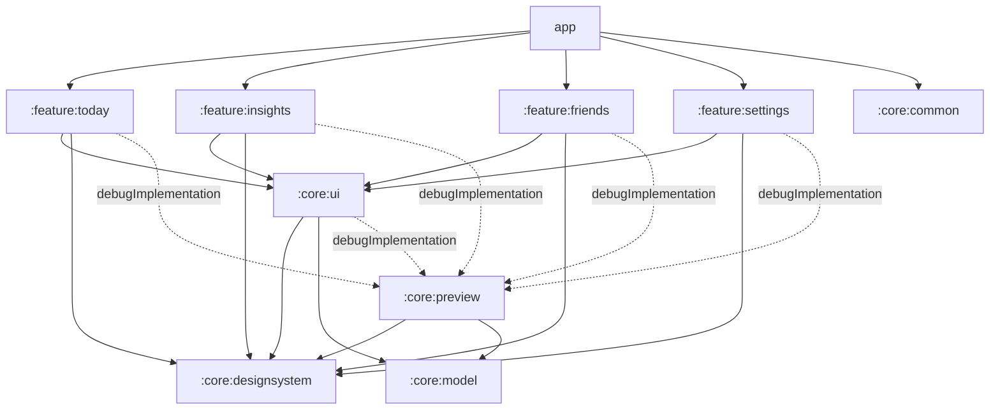

# Phase 2: Project Setup & UI Foundation

This phase sets up the build, theme, navigation and shared UI building blocks. No business logic yet: the screens show honest empty states until tracking (Phase 4) and accounts (Phase 3) exist.

## 1. Deliverables

| Deliverable | Where |
|---|---|
| Production project layout (feature-by-layer) | `app/`, `core/*`, `feature/*`, convention plugins in `build-logic/` |
| Material 3 theme: light, dark, dynamic color, typography, shapes | `core/designsystem/.../theme/` |
| Type-safe navigation with Navigation Compose | `feature/*/navigation/`, `app/.../navigation/` |
| State wrappers: Loading, Empty, Error, Offline | `core/ui/.../state/UiState.kt`, `StateContent.kt` |
| Reusable cards, buttons, dialogs, skeleton loaders | `core/designsystem/.../component/` |
| Transparency components (metric badge, platform card) | `core/ui/.../metric/` |
| Preview providers isolated from production code | `core/preview/` + each module's `src/debug/` |
| CI (build, unit tests, lint) | `.github/workflows/ci.yml` |

## 2. Toolchain

| Tool | Version | Why |
|---|---|---|
| Android Gradle Plugin | 9.4.1 | Latest stable. AGP 9 compiles Kotlin itself ("built-in Kotlin"), so `org.jetbrains.kotlin.android` is not applied anywhere. |
| Gradle | 9.8.1 | AGP 9.4 needs Gradle ≥ 9.6. |
| Kotlin | 2.4.21 | Also the Compose compiler version. |
| KSP / Hilt | 2.3.12 / 2.60.1 | Hilt's processor also gets `kotlin-metadata-jvm` so it can read current Kotlin metadata. |
| Compose BOM | 2026.09.00 | Material 3 1.4.0, Compose UI 1.12.1. |
| compileSdk | 37 | Required by `core-ktx` 1.19 and Compose UI 1.12 (their `minCompileSdk` is 37). |
| targetSdk | 36 | Google Play's current minimum. Moving to 37 brings Android 17 behavior changes and is a separate, tested step. |
| minSdk | 26 | Decision D7. `java.time` and adaptive icons are native from 26. |
| JDK | 17+ | Android Studio's bundled JDK works. |

All versions live in [`gradle/libs.versions.toml`](../../gradle/libs.versions.toml). Lint's "newer version available" checks are turned off. Bumps are deliberate, reviewed changes.

## 3. Module graph



**Changes from the Phase 1 proposal.** Phase 2 creates only modules that have code today.
- **Not yet created:** `:core:domain`, `:core:data`, `:core:database`, `:core:datastore`, `:core:network`, `:core:tracking`, `:core:work`, `:core:testing`, and the auth, onboarding, profile and leaderboard features. Each appears in the phase that needs it. With the convention plugins, a new module is a three-line build file.
- **Two new modules:**
  - `:core:common`: dispatchers and the network monitor.
  - `:core:preview`: preview-only sample data.

## 4. Conventions

### Build

| Plugin | Applies to | What it does |
|---|---|---|
| `reelcounter.android.application` | `:app` | SDK levels, Java 17, lint (whole-app report via `checkDependencies`) |
| `reelcounter.android.application.compose` | `:app` | Compose compiler, BOM, debug-only tooling |
| `reelcounter.android.library` | Android libraries | Same as above, plus a **resource prefix** derived from the module path (`:core:ui` → `core_ui_`) |
| `reelcounter.android.library.compose` | Compose libraries | Compose compiler, BOM, stability config |
| `reelcounter.android.feature` | `:feature:*` | Library + Compose + Hilt + serialization, and the standard feature dependencies |
| `reelcounter.hilt` | Any module with injection | KSP + Hilt (Android or JVM flavor) |
| `reelcounter.jvm.library` | `:core:model` | Pure Kotlin/JVM |

- `-PwarningsAsErrors=true` turns Kotlin warnings into errors. CI sets it.
- `compose_compiler_config.conf` marks `:core:model` types, `LocalDate` and `Duration` as stable, so screens that take them skip recomposition correctly.

### Architecture rules

1. **Features never depend on other features.** Cross-feature navigation is wired in `ReelCounterNavHost` through lambdas.
2. **Each feature owns its routes** in a `navigation/` package:
   - a `@Serializable` route object;
   - a `NavGraphBuilder.xScreen()` extension;
   - a `NavController.navigateToX()` extension.
   Tabs with sub-screens use a nested graph (`SettingsGraph`), so the tab stays selected on sub-screens.
3. **Screens come in two layers.**
   - A stateful `XScreen(viewModel = hiltViewModel())` collects state with `collectAsStateWithLifecycle`.
   - A stateless `XScreen(uiState, …)` renders it.
   - Previews and tests use only the stateless one.
4. **Screen ViewModels expose `StateFlow<UiState<T>>`.** `StateContent` renders the Loading, Empty, Error and Offline cases consistently, and the screen supplies only its success content. Most screens also override the empty copy.
5. **Text lives in string resources.** ViewModels hold `UiText`, never a `Context`.

### Previews are isolated from production code

- **Previews** (`@Preview` functions) live in `src/debug/` of each module.
- **Sample data and `PreviewTheme`** live in `:core:preview`, which modules add only with `debugImplementation`.
- **Compose tooling** (`ui-tooling-preview`) is also debug-only.

So a preview or sample object referenced from `src/main` **fails to compile in release**. Isolation is enforced by the build, not by convention. `:core:designsystem` can't use `:core:preview` (that would create a cycle), so its previews wrap themselves in the theme directly.

### Design tokens

| Token | Use |
|---|---|
| `MaterialTheme.colorScheme` | All standard colors. Dynamic on Android 12+, otherwise the indigo/coral brand palette. |
| `ReelCounterTheme.metricColors` | Verified, Estimated, App time only and Not tracked. These stay fixed under dynamic color so categories look the same everywhere. "Not tracked" follows the active neutrals. |
| `Spacing.*` | 4 dp grid (`xs` 4 … `xxxl` 48), plus `minTouchTarget` 48 dp |
| `MaterialTheme.typography` | M3 scale; display styles use tabular figures (`withTabularNumbers()`) |
| `MaterialTheme.shapes` | 4 / 8 / 12 / 16 / 28 dp corners |
| `RcIcons` | Every icon the app uses, in one file |

### Components

**`:core:designsystem` (no app-specific copy):**
- `RcButton`, `RcOutlinedButton` and `RcTextButton`. They have a loading state that prevents double submission and a 48 dp minimum height.
- `RcCard` (one merged accessibility item) and `RcStatCard`.
- `RcTag`, `RcTopAppBar`, and `RcAlertDialog` (with a destructive variant).
- `SkeletonBlock`, `SkeletonText`, `SkeletonCard` and `SkeletonList`. The shimmer redraws without recomposing, stops when "Remove animations" is on, and is announced once as "Loading".
- `EmptyState`, `ErrorState`, `OfflineState`, `OfflineBanner` and `RcLoadingIndicator`.

**`:core:ui`:**
- `UiState` and `UiText`.
- `StateContent`.
- `MetricQualityBadge`.
- `PlatformActivityCard`: it encodes the Phase 1 display rules ("≈" plus a range for estimates, "app time" wording, no count for duration-only days, a badge on every figure).
- `formatAppTime`.

### Accessibility built in

- **Meaning never relies on color alone:** every metric badge pairs an icon with text.
- **Touch targets** are at least 48 dp.
- **Cards** read as one item. Section titles and state titles are marked as headings.
- **The offline banner** is a polite live region.
- **Skeleton placeholders** are hidden from screen readers; the list is announced as "Loading".
- **Font scaling:** previews include font-scale variants of the busiest components.
- **Platform logos** are not used (Phase 1 risk R6); cards show a letter monogram.

### App shell

- **`NavigationSuiteScaffold`** adapts navigation to the window: a bottom bar on phones, a rail or drawer on larger screens.
- **Tab back stacks** are saved and restored when switching tabs.
- **Edge-to-edge** and the **splash screen** are set up in `MainActivity`.
- **Offline notice:** losing connectivity shows a persistent snackbar, which disappears on reconnect.
- **Backups:** `allowBackup` is off until Phase 8 defines explicit backup rules, so auth sessions and usage history never leave the device in a backup.

## 5. Verification

### Results (19 Oct 2026, Windows, Temurin JDK 17.0.20, SDK platform `android-37.0`, build-tools 37.0.0)

| Check | Result |
|---|---|
| `./gradlew assembleDebug testDebugUnitTest :core:model:test :app:lintDebug -PwarningsAsErrors=true` (the CI command) | **Pass.** No Kotlin warnings; lint reports "No issues found" across all modules. |
| Unit tests | **9/9 pass:** `PlatformMetricTest` (4), `AppTimeFormatTest` (5) |
| `./gradlew assembleRelease` (R8 minify + resource shrinking) | **Pass:** 1.3 MB unsigned APK |
| Preview isolation | `:core:preview` and `ui-tooling*` appear on `debugRuntimeClasspath` and are **absent** from `releaseRuntimeClasspath`. Release compiles every module without `src/debug`. |
| Release manifest | Permissions: `ACCESS_NETWORK_STATE`, plus AndroidX's signature-level `DYNAMIC_RECEIVER_NOT_EXPORTED_PERMISSION`. targetSdk 36, minSdk 26. |
| On a device or emulator | **Not run yet.** No emulator is installed; see the manual checks below. |

Fixes made during verification:
- `RcTopAppBar` no longer takes a scroll behavior, because exposing the experimental type forced every caller to opt in.
- Unit tests depend on `kotlin-test-junit`, since AGP's built-in Kotlin doesn't infer the JUnit flavor.
- Two lint settings that AGP 9.4 deprecated were removed.
- Explicit `data_extraction_rules.xml` and `backup_rules.xml` were added. On Android 12+, `allowBackup="false"` alone doesn't stop device-to-device transfer.

### How to verify yourself

1. **Sync:** open the project in Android Studio and wait for Gradle sync to finish without errors.
2. **Build and checks:**
   ```bash
   ./gradlew assembleDebug testDebugUnitTest :core:model:test :app:lintDebug
   ```
3. **Previews:** open the preview pane for:
   - `DesignSystemPreviews.kt`: colors, type, buttons, cards, tags, skeleton, states, dialog;
   - `CoreUiPreviews.kt`: the platform card in every category, badges, `StateContent` states;
   - `TodayScreenPreviews.kt`: the populated, loading and empty Today screen, on phone, foldable and tablet.
4. **On a device:**
   - Switch tabs; each tab keeps its place.
   - Open Settings → How ReelCounter counts → back.
   - Toggle airplane mode: the offline snackbar appears, then clears on reconnect.
   - Try light and dark mode, and a large font size.
   - Rotate the device, or use a tablet emulator, to see the navigation rail.

## 6. Known gaps (deliberately deferred)

| Gap | Planned |
|---|---|
| Not yet run on a device or emulator; previews not yet rendered in Android Studio | Your review (manual checks above) |
| Release signing | Phase 10 |
| User theme override (light/dark/system, dynamic color on/off) | Phase 8 settings |
| Screenshot and UI tests | Phase 9 |
| Launcher icon is a placeholder mark | Before release |
| Today shows an empty state; real data arrives with the tracking engine | Phase 4 |
