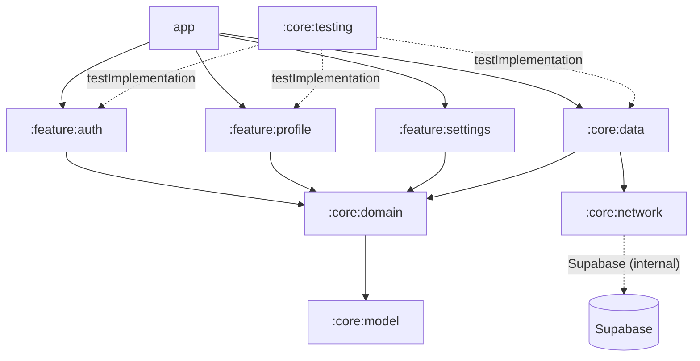
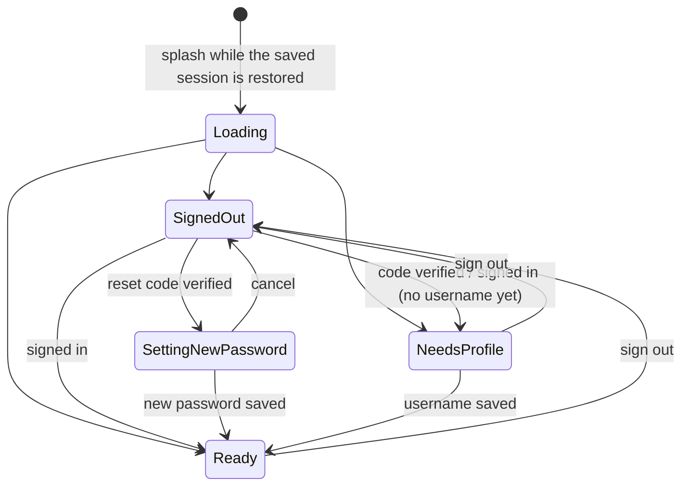
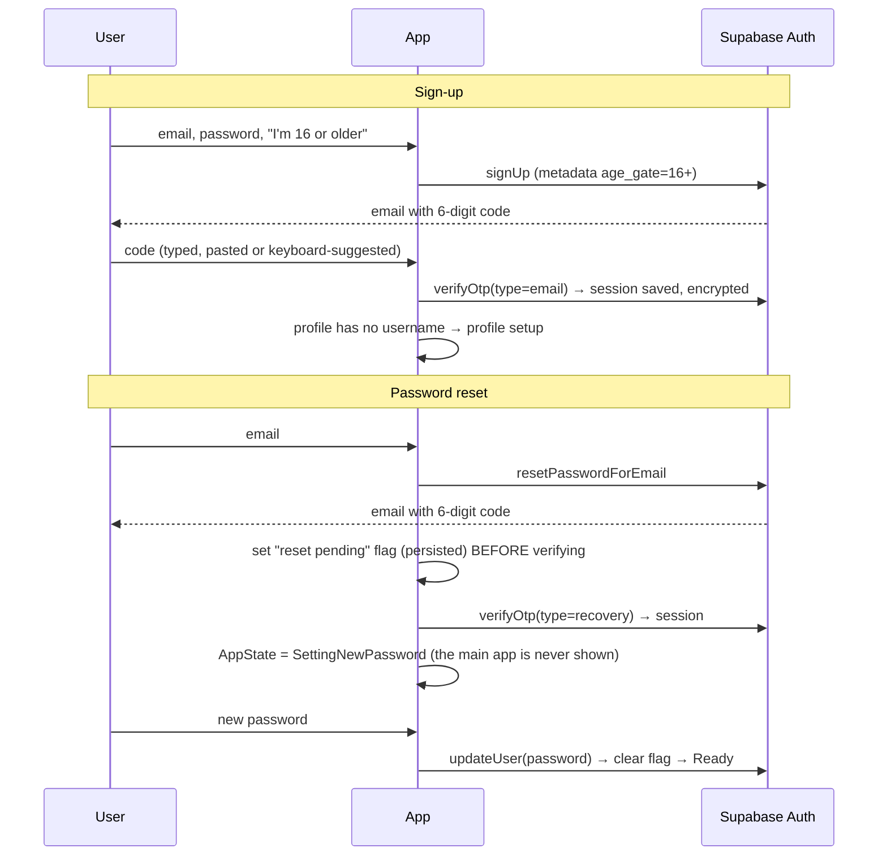

# Phase 3: Authentication & User Profiles

Email/password accounts on Supabase Auth. Email ownership is proven with **6-digit codes**, both at sign-up and for password resets. Each user also gets a profile: a unique username, a display name, an avatar and a bio. All of this is enforced on the server by row level security (RLS) and constraints, and the client only mirrors those rules.

## 1. Deliverables

| Deliverable | Where |
|---|---|
| Registration, email verification by code | `feature/auth` (`SignUpScreen`, `VerifyEmailScreen`) |
| Login | `feature/auth/signin` |
| Password reset by code | `ForgotPasswordScreen` → `ResetCodeScreen` → `SetNewPasswordScreen` |
| Session persistence (encrypted) | `core/network/session/EncryptedAuthStorage.kt`, `KeystoreCipher.kt` |
| Profile setup and editing (username, display name, avatar, bio) | `feature/profile` |
| Unique usernames, checked on the client and enforced by the database | `UsernameRules` (`core/domain`), `profiles.username` unique + `CHECK`, `public.check_username()` |
| Secrets in BuildConfig with a service-role guard | `build-logic/.../AndroidSecretsConventionPlugin.kt`, `Secrets.kt`, `secrets.defaults.properties` |
| RLS migration: users edit only their own profile | `supabase/migrations/20261019120000_identity_and_profiles.sql` |
| Migration and RLS test suite | `supabase/tests/pglite` (39 checks, runs in CI) |

## 2. Architecture

New modules, following the Phase 1 plan:



| Module | Responsibility |
|---|---|
| `:core:domain` (pure Kotlin) | `AuthRepository` and `ProfileRepository` contracts, typed errors (`AuthError`, `ProfileError`), `Outcome`, and validation rules that mirror the database |
| `:core:network` | The **only** module that talks to Supabase. Exposes data-source interfaces and `RemoteException`; Supabase and Ktor types never leak out of it. Also owns `SupabaseConfig`, the encrypted session storage and BuildConfig secrets. |
| `:core:data` | Repository implementations: error mapping, the password-reset flag, avatar processing, and keeping the profile in sync with sign-in state |
| `:core:testing` | Fakes and `MainDispatcherRule` for unit tests |
| `:feature:auth` | Sign-in, sign-up, code entry, forgot/reset password. `AuthFlow()` owns its own back stack. |
| `:feature:profile` | One editor for first-run setup and later edits, with live username availability and the photo picker |

### What the app shows

`MainActivityViewModel` derives one `AppState` from auth state and profile state. `ReelCounterRoot` then shows exactly one experience. Each one is a separate composition, so signing out can't leave screens from the signed-in app on the back stack.



- **`NotConfigured`:** the build has placeholder secrets.
- **`ProfileUnavailable`:** the profile failed to load. The user can retry or sign out.

### Flows



**Why codes and not links:**
- They work when the email is opened on another device.
- The user never leaves the app.
- There's no deep-link redirect that another app could intercept.

## 3. Security hardening

| Control | How |
|---|---|
| **No server keys in the app** | Only the publishable (anon) key is ever built in. The secrets plugin **fails the build** if a value is an `sb_secret_…` key or a JWT whose role is `service_role`, or if the URL isn't HTTPS. Plain HTTP is allowed only for a local Supabase at `10.0.2.2`, `localhost` or `127.0.0.1`. All three guards were tested by putting those values in `secrets.properties`. |
| **Secrets out of git** | `secrets.properties` is git-ignored. `secrets.defaults.properties` holds placeholders and declares which keys exist, so only those keys reach BuildConfig. |
| **Encrypted session** | Access and refresh tokens and the PKCE verifier are encrypted with AES-256-GCM using a non-exportable Android Keystore key, then stored in DataStore. supabase-kt's default would be plain SharedPreferences. |
| **No backups** | Auth data is excluded from cloud backup and device transfer (Phase 2 rules), so tokens never leave the device. |
| **Server-side authority** | RLS limits users to their own profile and settings. Column grants allow only `username`, `display_name`, `avatar_path` and `bio` to be changed. Inserts and deletes are trigger- or server-only. |
| **Username integrity** | Unique index plus a format `CHECK` plus a reserved-name trigger (`RC001`). `check_username()` returns only a status word, never another user's data. |
| **Avatar isolation** | Storage policies allow writes only inside the user's own `{uid}/` folder, and a `CHECK` stops a profile from pointing at another user's file. Bucket limit: 1 MB, WebP/JPEG only. |
| **Photo privacy** | Avatars are re-encoded to 512 px, which strips EXIF data including GPS location. The system photo picker needs no storage permission. |
| **Passwords** | At least 8 characters, at most 72 bytes (bcrypt), no composition rules (NIST 800-63B). The server's weak and breached checks are surfaced. Password fields are marked for password-manager autofill. |
| **Minimum age** | A required "I'm 16 or older" confirmation (D4), recorded in user metadata. |
| **Account enumeration** | Reset-code requests succeed silently for unknown emails. |
| **Transport** | HTTPS only in release. The cleartext exception for a local Supabase lives in `src/debug` only. |

## 4. Database (`supabase/migrations/20261019120000_identity_and_profiles.sql`)

**Objects created:**
- `private` schema (not exposed through the API)
- `visibility_level` enum
- tables `profiles` and `user_privacy_settings`
- `private.reserved_usernames`
- triggers: create profile and settings on sign-up, `updated_at`, reserved-name check
- RPC `public.check_username(text)`
- the `avatars` bucket and its storage policies

**Differences from the Phase 1 proposal:**
- `profiles` SELECT is **own row only** for now. Phase 6 widens it to friends and public profiles once friendships exist.
- `check_username()`, the reserved-name list and the `avatar_path` ownership check are new.
- `user_privacy_settings` gets column-level update grants.

**Test suite:** `supabase/tests/pglite`
- It applies the migrations to PGlite (Postgres compiled to WebAssembly) with minimal Supabase stubs: roles, default grants, `auth.uid()`, `auth.users`, and the storage tables.
- It then runs **39 checks** as the real API roles.
- No Docker is needed, and CI runs it as the `database` job.

```bash
cd supabase/tests/pglite && npm ci && npm test
```

## 5. Setting up Supabase

### Hosted project

1. **Create a project** at [supabase.com](https://supabase.com).
2. **Apply the migration**, either way:
   - With the Supabase CLI: `supabase link --project-ref <ref>`, then `supabase db push`.
   - Or paste `supabase/migrations/20261019120000_identity_and_profiles.sql` into the SQL editor and run it once.
3. **Configure auth** (Authentication → Providers → Email):
   - Confirm email: **on**
   - Minimum password length: **8**
   - Email OTP length: **6**
   - Optional, Pro plan: leaked password protection
4. **Edit the email templates** (Authentication → Email Templates):
   - "Confirm signup": paste `supabase/templates/confirmation.html`.
   - "Reset password": paste `supabase/templates/recovery.html`.
   - Both show `{{ .Token }}`. The default templates send links, which the app doesn't use.
5. **Point the app at the project** with `secrets.properties` in the repo root (git-ignored), using values from Settings → API:
   ```properties
   SUPABASE_URL=https://<ref>.supabase.co
   SUPABASE_PUBLISHABLE_KEY=<publishable or anon key>
   ```
   **Never** use the secret or `service_role` key. The build refuses it.
6. **Use custom SMTP for production.** Supabase's built-in email sender is rate-limited and meant for testing.

### Local development (Docker)

- Running `supabase start` applies `config.toml`, the migrations and the templates.
- Then set `SUPABASE_URL=http://10.0.2.2:54321` (the emulator's view of your machine) and the local publishable key from `supabase status`.
- Emails are caught by the local inbox shown in `supabase status`.

## 6. Verification

| Check | Result |
|---|---|
| Migration and RLS suite (PGlite) | **39/39 pass** |
| Unit tests | **56/56 pass** across 11 suites: domain rules, error mapping, auth repository (including reset-flag ordering), profile repository (avatar upload/cleanup), ViewModels for sign-in, sign-up, code entry (auto-verify, resend cooldown on virtual time) and the profile editor (debounced availability, save) |
| `assembleDebug -PwarningsAsErrors=true` | **Pass** |
| Secrets guard | Fails the build for a `service_role` JWT, an `sb_secret_` key and a non-local `http://` URL; allows `http://10.0.2.2` |
| App-wide lint (`:app:lintDebug`, all modules) | **No issues** (warnings fixed: plurals for counts, KTX helpers) |
| `assembleRelease` (R8) | **Pass**, 2.6 MB unsigned APK. supabase-kt, Ktor and kotlinx.serialization need no extra R8 rules so far; Phase 10 reviews the rules. |
| Against a real Supabase project, on a device | **Not done.** There's no project and no emulator yet; follow §5, then try the flows. |

## 7. Known gaps

| Gap | Planned |
|---|---|
| End-to-end test against a real Supabase project | After you create the project (§5) |
| Change email or password while signed in; delete account | Phase 8 |
| Avatar files orphaned if both the old-file delete and the rollback fail | Phase 8 storage sweep |
| Android 8.x ignores EXIF rotation when processing avatars (ImageDecoder handles 9+) | Accepted; revisit if reported |
| Profiles readable by friends; username search | Phase 6 |
| Social sign-in (Google, etc.) | Not planned |
