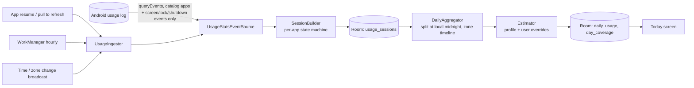

# Phase 4: Tracking Engine & Local Data

Measures how long the chosen apps are in the foreground, using Android's usage log, and turns that into daily figures labeled **Estimated** or **App time only**. Everything stays on the device in this phase. Uploading comes in Phase 5.

## 1. Deliverables

| Deliverable | Where |
|---|---|
| App selection and permission lifecycle (prominent disclosure, usage-access intent, revoke detection) | `feature/tracking/setup`, `core/tracking/AppOpsUsageAccessMonitor.kt`, `feature/tracking/UsageAccessSettings.kt` |
| Foreground session tracker on `UsageStatsManager` | `core/tracking/UsageStatsEventSource.kt` → `core/domain/tracking/SessionBuilder.kt` |
| Estimation engine: platform constants plus user-adjusted parameters | `core/domain/tracking/Estimator.kt`, `PlatformCatalog.kt`; sliders in `feature/tracking/settings` |
| Local persistence: Room and DataStore | `core/database` (6 tables, schema exported to `core/database/schemas`), `core/datastore` (consent, pause) |
| Background engine: offline-first, duplicate-safe, reboot and midnight handling | `core/data/tracking/UsageIngestor.kt`, `core/work` (`UsageIngestWorker`, `TimeChangeReceiver`) |
| Today screen with real data | `feature/today` |

The roadmap's "background sync engine" here is the **local** pipeline (usage log → Room). Uploading daily rows to Supabase, with retry and conflict handling, is Phase 5. The rows already carry `revision` and `dirty` for it.

## 2. Pipeline



Pure logic (session building, bucketing, aggregation, estimation) lives in `:core:domain` and is tested without Android. `:core:tracking` holds only thin OS adapters.

### Each read (`UsageIngestor.ingest`)

1. **Guards.** The disclosure must be accepted, usage access granted, tracking not paused, and the device unlocked. Otherwise nothing is read.
2. **Window.** Reading starts 10 minutes before the last watermark, or at the start of any still-open session, whichever is earlier. It never starts before the last resume, so paused time is never read. On the very first read, it backfills from yesterday's midnight.
3. **Sessions.** Events become sessions.
   - An app is in the foreground while any of its activities is resumed.
   - A pause followed by a resume within 2 s is merged into one session.
   - Screen off, the lock screen and shutdown end sessions.
   - A startup without a shutdown event ends open sessions at the last event seen.
4. **Replace, don't append.** Sessions from the first event returned onward are deleted and re-derived, so overlapping reads are idempotent and nothing is double-counted. If the read returned nothing, nothing is deleted.
5. **Daily rows.**
   - Non-final days in the read window are recomputed from all stored sessions.
   - Each session is dated in the time zone in effect when it started, and split at that zone's midnight (23 h and 25 h DST days work naturally).
   - Covered days get a row for every tracked app, even at 0 min, so "0 min" and "no data" stay distinct.
   - Rows whose figures didn't change aren't rewritten, which keeps Phase 5 uploads minimal.
6. **Coverage.** The part of each day actually read is recorded. If the gap since the last read is longer than the assumed retention (3 days), only the part from the first surviving event counts, and earlier days show **Not tracked (no data recorded)**, never zero.
7. **Finalize.** Days before today − 2 become final and are never recomputed: their raw events may have expired.
8. **Prune.** Raw sessions older than 35 days are deleted. Daily totals stay.

Steps 4–8 run in one Room transaction, behind a mutex, so concurrent triggers (worker plus screen resume) are safe.

### Triggers

| Trigger | Why |
|---|---|
| Today screen resumes, pull to refresh | Fresh numbers whenever the user looks, even if background work was delayed |
| `UsageIngestWorker` every hour (unique periodic work) | Keeps reading while the app isn't open, so events are read before they expire |
| `TimeChangeReceiver` (`TIMEZONE_CHANGED`, `TIME_SET`) | Records the new zone immediately (travel), then recomputes recent days |
| Pause / resume | Reads everything up to the pause, closes open sessions, and on resume reads only from the resume moment |
| Reboot | Nothing needed: WorkManager restores its schedule, and the usage log survives reboots. Shutdown and startup events close sessions correctly. |
| Midnight | `CurrentDateProvider` ticks at local midnight and on date, time or zone changes, and Today switches to the new day |

## 3. Estimation

```
reels ≈ app time × short-form share ÷ seconds per reel
range = (app time × share_low ÷ seconds_high) … (app time × share_high ÷ seconds_low)
```

**User overrides:**
- The user can override the share and the seconds per platform.
- The range then becomes ±20 % around their values, and figures show **Adjusted by you**.
- Changes apply to non-final days only. Older days keep the figures and `estimation_version` they were recorded with, so history is never silently rewritten.

**Defaults (decision D1):**
- TikTok and Instagram: Estimated.
- YouTube and Facebook: App time only, until the user turns on estimation in Tracking & apps.

> **The v1 parameters below are unvalidated placeholders.** Spike S2 (calibration against hand counts) must replace them and bump `EstimationProfile.version`. The app says they're rough assumptions wherever they're shown.

| Platform | Short-form share (range) | Seconds per reel (range) | Estimated by default |
|---|---|---|---|
| TikTok | 95 % (85–100) | 21 (12–35) | yes |
| Instagram | 55 % (30–80) | 18 (10–30) | yes |
| YouTube | 30 % (10–60) | 30 (15–50) | no |
| Facebook | 20 % (5–50) | 20 (10–35) | no |

## 4. Local data model

**Room (`reelcounter.db`, v1):**
- `usage_sessions` (package, start) PK
- `daily_usage` (date, platform) PK, carrying `quality`, the estimates, `estimation_version`, `user_adjusted`, `tz_id`, `is_final`, `revision` and `dirty`
- `day_coverage`
- `platform_settings`
- `zone_changes`
- `ingest_state`

Room checks every query at compile time.

**DataStore (`tracking_preferences`):** disclosure version and acceptance time, the paused flag, and the last resume time.

## 5. Policy and privacy

| Requirement | How |
|---|---|
| **Prominent disclosure** (Play User Data policy) | Shown before usage access is requested. It says what's read, what isn't, that other apps are ignored, where data lives, that counts are estimates, and how to stop. Accepting is an explicit tap, and the version and time are stored. `CURRENT_DISCLOSURE_VERSION = 1`; Phase 5 **must** update the text (uploads) and bump the version so everyone re-accepts. |
| **Usage access** | Declared with `tools:ignore="ProtectedPermissions"`. The user grants it in system settings; the app watches the app-op and reacts to revokes immediately. |
| **Package visibility** | `<queries>` lists only the 8 catalog packages. **No `QUERY_ALL_PACKAGES`.** |
| **Data minimization** | Only catalog apps' events are kept (other apps are dropped while the log is read). Untracked platforms aren't stored. Raw sessions are pruned after 35 days. |
| **No foreground service, accessibility service, VPN or screen capture** | None are used. Background work is plain WorkManager. |
| **Battery-optimization exemptions** | Not requested (`REQUEST_IGNORE_BATTERY_OPTIMIZATIONS` is Play-restricted). See gaps. |

## 6. Verification

| Check | Result |
|---|---|
| Engine tests (pure) | `SessionBuilderTest` 11, `DayBucketerTest` 7 (midnight split, both DST days, travel), `EstimatorTest` 7, all pass |
| Ingestor tests (in-memory store) | `UsageIngestorTest` 10: backfill, idempotent re-reads, open-session extension, midnight split, consent/permission gate, pause excludes paused time, finalization, expired-log gap, untracked apps, estimate recompute. All pass after one fix (below). |
| ViewModel tests | `TrackingSetupViewModelTest` 6, `TodayViewModelTest` 4, all pass |
| Whole project | **101 unit tests in 17 suites, 0 failures**. `assembleDebug -PwarningsAsErrors=true` passes with no warnings. Room verifies every query at compile time. |
| App-wide lint, R8 release | Lint: no issues (production sources; see the lint note in §8). `assembleRelease` passes. |

### Bug found by the tests

The ingestor computed "today" from the system clock instead of the injected `TimeSource`, so reads near midnight could pick the wrong day. It now uses `TimeSource` everywhere. A search confirmed no other direct clock reads in the data, domain or feature code.

## 7. Not verified yet (needs a real device)

These are the Phase 1 spikes. They can't be done without hardware:

| Spike | What to check |
|---|---|
| **S1: usage-log fidelity** | On Pixel, Samsung and Xiaomi (Android 12–16): how long raw events are kept, whether resume/pause pairs are reliable, and what happens around shutdown, picture-in-picture and split screen. Compare our app time with Digital Wellbeing's for the same day. |
| **S2: estimator calibration** | Count reels by hand during timed sessions per platform, then replace the placeholder profiles. |
| **OEM background behavior** | Whether the hourly worker runs on aggressive battery managers. Gaps then show as "No data recorded". |

**Manual test plan on a device:**
1. Set up tracking, use TikTok for 2 minutes, then open Today. A TikTok card shows about 2 min with an Estimated badge.
2. Pull to refresh repeatedly. Numbers don't grow.
3. Pause, use TikTok, then resume. The paused time isn't counted.
4. Revoke usage access in system settings. Today shows the "Usage access is off" notice immediately.
5. Change the time zone in system settings. Recent days are re-dated.
6. Leave the app open across midnight. Today switches to the new date.

## 8. Known gaps

| Gap | Planned |
|---|---|
| Upload of daily rows; disclosure v2 | Phase 5 |
| OEM-specific "keep ReelCounter running" guide when gaps are detected (L5) | Phase 7 |
| Partial-day coverage is stored but not yet shown on cards | Phase 7 |
| Manual correction of a day's count (D2: stays Estimated, "Adjusted by you") | Phase 7 |
| Room migration tests (only v1 exists) | Phase 9 |
| Lint skips unit-test sources (`ignoreTestSources`). Lint 32.4.1 intermittently crashed inside its Kotlin 2.4 analysis on a test file; a rerun passed. Production code is fully linted. | Re-enable after the next AGP/lint update |
| Android 8–8.1 lack screen-off and shutdown events; sessions there end on the activity pause, which Android also sends at screen-off | Accepted |
