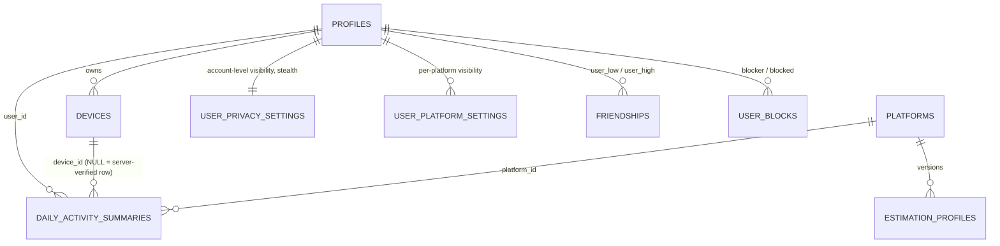
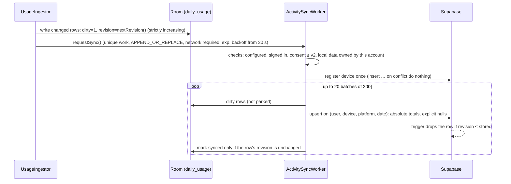

# Phase 5: Backend Integration & Activity Data Model

Daily totals now leave the device. Each device uploads its own rows to the user's account. Row level security (RLS) decides, row by row, who else may read them: the owner, accepted friends, or the public, subject to every privacy switch and to blocks.

## 1. Deliverables

| Deliverable | Where |
|---|---|
| Normalized tables `profiles`, `friendships`, `daily_activity_summaries`, `user_privacy_settings`, plus `devices`, `user_platform_settings`, `user_blocks`, `platforms`, `estimation_profiles` | `supabase/migrations/20261019120000_identity_and_profiles.sql` (Phase 3) and `supabase/migrations/20261020120000_activity_and_social_graph.sql` (this phase) |
| RLS: owners control their own data; friends get granular read access | Same migration, §RLS; tested in `supabase/tests/pglite` (**82 checks**) |
| Client sync with retry backoff and conflict resolution | `core/data/sync/ActivitySyncer.kt`, `core/work/ActivitySyncWorker.kt` (WorkManager), `core/network/activity/` |
| Account separation on shared phones | `core/data/sync/AccountDataGuard.kt` |
| Disclosure v2 (uploading) | `feature/tracking` strings; `CURRENT_DISCLOSURE_VERSION = 2` |

Friend-request *writes* (send, accept, reject, block, cancel) are SECURITY DEFINER RPCs in Phase 6. In this phase, friendships and blocks are read-only to their participants, and tests create them as the database owner.

## 2. Data model



`daily_activity_summaries` holds one row per (user, device, platform, local date), with absolute totals. Its guard trigger enforces:
- plausible dates;
- immutable key columns;
- **stale revisions dropped silently** (`revision <= stored` → the update is skipped).

The `daily_activity_totals` view sums devices per user, platform and day, and uses `security_invoker` so the caller's RLS applies.

## 3. Who can see what

| Data | Owner | Accepted friend | Pending-request counterpart | Stranger | Blocked (either way) |
|---|---|---|---|---|---|
| Profile card | ✔ | ✔ | ✔ | only if `profile_visibility = public` | ✘ |
| Daily activity, per platform | ✔ | if account-level **and** platform visibility allow it (`friends`/`public`) and not in stealth | ✘ | only if both are `public` and not in stealth | ✘ |
| Privacy settings, platform settings, devices | ✔ | ✘ | ✘ | ✘ | ✘ |
| Friendships | own rows | own rows | own rows | ✘ | ✘ |
| Blocks | the blocker only | – | – | – | the blocked person can't detect it |

The rules live in `private.can_view_profile` and `private.can_view_activity`. They are SECURITY DEFINER helpers in a schema the API doesn't expose, so they can't be called to probe relationships. Clients can never write `VERIFIED` figures or `data_portability` rows; only the server can.

## 4. Sync protocol



| Concern | Rule |
|---|---|
| **Idempotency** | Absolute totals on a unique key. Retrying any batch any number of times converges to the same server state. |
| **Conflicts** | Revisions grow strictly per device, even if the clock is turned back (`ingest_state.last_revision`). The server keeps the higher revision, so a late retry can't overwrite newer figures. |
| **Concurrent edits** | A row changed while its upload was in flight keeps `dirty = 1` (the mark-synced update matches on the revision), so it goes up again. |
| **Bad data** | If the server rejects a batch with a data or constraint error (SQLSTATE 22/23), the batch is retried row by row. A row that is itself invalid is parked with its error code and not retried; the others go through. |
| **Transient errors** | Offline, timeout or a server error returns `RetryLater`, and WorkManager backs off exponentially. |
| **Device ownership** | A server "permission denied" on the device makes the app rotate to a new device id and register again. |
| **Triggers** | Every read that changed rows, estimation-setting changes, and every sign-in. |

### Shared phones (`AccountDataGuard`)

- The first account to sign in adopts what the device has already recorded.
- If **another** account signs in later:
  - the previous account's local tracking data and tracking consent are erased;
  - the new account gets a new device id;
  - the new account must agree to the disclosure itself;
  - only usage from that moment on is read for it.
- One account's usage therefore can never be uploaded to another's.

## 5. Consent

**Disclosure version 2** adds two statements:
- Daily totals per app are saved to the account; detailed session times stay on the device.
- Accepted friends can see the totals, and Privacy settings to control this are coming.

**Effects:**
- Users who accepted v1 see the disclosure again.
  - While v2 isn't accepted, nothing is read or uploaded.
  - Users who already have usage access go straight back to tracking after accepting.
- Uploads require consent version ≥ 2 (`UPLOAD_CONSENT_VERSION`).

## 6. Applying the migration

```bash
supabase db push
```

Without the CLI, paste `supabase/migrations/20261020120000_activity_and_social_graph.sql` into the SQL editor once, after the Phase 3 migration.

## 7. Verification

| Check | Result |
|---|---|
| SQL suite (PGlite, both migrations) | **82/82 pass**. New: device ownership, upload rules (no VERIFIED, no other devices, constraints), stale revision ignored, key immutability, and the full visibility matrix (friend, stranger, private platform, private account, stealth, public, block, pending request, totals view, anon). |
| Unit tests | **112 pass** in 19 suites. New: `ActivitySyncerTest` (consent and sign-in gates, device registration, explicit nulls, change during upload, offline, bad-row isolation, foreign data), `AccountDataGuardTest`, ingestor revision after a clock change, setup re-consent. |
| Build, lint, R8 release | `assembleDebug -PwarningsAsErrors=true` passes; lint reports no issues; `assembleRelease` passes. Room schema v2 exported next to v1. |

### Bug found by the tests

After the clock was turned back, the read window started at the old (future) watermark, so new usage would have been skipped until the clock caught up. Each read now looks back at least 10 minutes from the current time; the pause boundary still applies.

## 8. Not verified yet

- Against a real Supabase project (see Phase 3 §5), and on a device.
- How Supabase's PostgREST `on_conflict` behaves with the `NULLS NOT DISTINCT` constraint. PGlite runs the same SQL statement, but PostgREST itself isn't in the loop.

## 9. Known gaps and decisions

| Item | Status |
|---|---|
| **Default activity visibility is `friends`, but the privacy controls UI arrives in Phase 8.** Once Phase 6 ships friend requests, accepted friends would see activity before users can change who sees what. | **Resolved:** a minimal "who can see my activity" control shipped in Phase 6 ([phase-6 §4](../phase-6/README.md#4-who-can-see-my-activity-resolves-phase-5-9)) |
| The app doesn't yet sync `user_platform_settings` (per-platform visibility is written by the Phase 8 privacy screen) | Phase 8 |
| Multi-device totals (`daily_activity_totals`) aren't shown in the app yet | Phase 7 |
| Parked (rejected) rows have no UI; they're kept with their error code for diagnostics | Phase 9 |
| Room v2 is an automatic, additive migration; no migration test yet | Phase 9 |
| Clearing local data on sign-out, deleting the account | Phase 8 |
