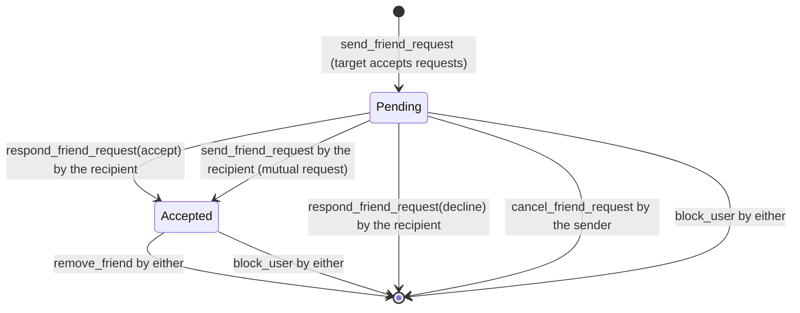

# Phase 6: Friends & Social

Users can find each other by username, send and answer friend requests, remove and block people, and (if both opt in) see which friends have the app open. Every action is decided on the server. As you asked, this phase also ships a minimal **"Who can see my activity"** control, so users can change visibility before any friend sees a number.

## 1. Deliverables

| Deliverable | Where |
|---|---|
| Username search that never exposes emails or settings | `public.search_profiles` in `supabase/migrations/20261021120000_friends_search_presence.sql` |
| Friend requests: send, accept, decline, cancel, remove, block, unblock | SECURITY DEFINER RPCs in the same migration |
| Server-side authorization and rate limits | Same migration; tested in `supabase/tests/pglite` (**138 checks**, 56 new) |
| Live request updates and opt-in online status (private Realtime channels) | Realtime policies in the migration; `core/network/realtime/RealtimeRemoteDataSource.kt`, `core/data/social/RealtimeCoordinator.kt` |
| Friends screen: search, requests, friends, sent, remove and block | `feature/friends` |
| **Privacy screen: who can see my activity**, online status, discoverability, friend requests, blocked accounts | new module `feature/privacy`, reached from Settings and from the Friends screen |

## 2. Friend-request state machine

One `friendships` row per pair of users. Every transition is an RPC that takes the caller from `auth.uid()`, never from a parameter, so nobody can act for someone else.



| RPC | Returns |
|---|---|
| `send_friend_request(target)` | `requested`, `accepted` (they had already asked you), `already_friends`, `already_requested`, `not_accepting`, `not_found` |
| `respond_friend_request(requester, accept)` | `accepted`, `declined`, `not_found` |
| `cancel_friend_request(target)` | `cancelled`, `not_found` |
| `remove_friend(target)` | `removed`, `not_found` |
| `block_user(target)` / `unblock_user(target)` | `blocked` / `unblocked`, `not_found` |
| `my_connections()` | your friends, incoming and outgoing requests (public card fields only) |
| `my_blocked_users()` | the people you blocked |

Privacy rules built into these RPCs:
- **Blocks are undetectable.** A blocked or non-existent user is always `not_found`, in both directions.
- **Declines are silent.** Declining deletes the request; the sender's request simply disappears.
- **Blocking removes the friendship** and any pending request, and stops search, requests, activity and presence both ways.
- Only the recipient can accept. Only the sender can cancel.

## 3. Search

`search_profiles(prefix, max_results)` returns `id, username, display_name, avatar_path` and your relationship with each result. It never returns emails, settings or activity.

- At least 2 characters. `%` and `_` are escaped, so they match literally.
- Excludes you, anyone blocked in either direction, and anyone who turned off **Let people find me**. People you're already connected with can still find you.
- The app waits until typing pauses (300 ms) and ignores answers for a query you've already changed.

**Rate limits** (per user, fixed window, error `RC002`, shown as "Wait a minute and try again"):

| Action | Limit |
|---|---|
| Search | 60 per minute |
| Friend requests | 30 per hour |

## 4. Who can see my activity (resolves Phase 5 §9)

The Privacy screen sets `user_privacy_settings` for your own row only. RLS rejects writes to anyone else's row, and the change applies on the server's next read, to past days as well as new ones.

| Setting | Options | Default |
|---|---|---|
| **Who can see my activity** | **Friends**, **Only me** (`private`) | Friends |
| Show when I'm online | on, off | **off** |
| Let people find me | on, off | on |
| Allow friend requests | on, off | on |
| Blocked accounts | list, with Unblock | empty |

- "Everyone" (`public`) isn't offered yet. It appears only if an account already has it, so the current value is never hidden.
- The Friends screen always shows a card with your current activity visibility and a **Change** button, so you see the setting before adding anyone.
- A change shows straight away. If the save fails, the screen goes back to the saved value and says so.

## 5. Realtime

Both channels are **private**: Supabase checks the policies on `realtime.messages` before letting anyone join.

| Channel | Who can join | What it carries |
|---|---|---|
| `friendships:<your id>` | only you (receive only; nobody can send on it) | an empty `changed` broadcast, sent by a database trigger to the two people in a friendship whenever it's created, accepted or deleted. The app then refetches its lists through `my_connections()`. |
| `presence:<user id>` | the owner (to track) and their accepted friends, only if the owner turned on **Show when I'm online**, isn't in stealth mode and there's no block | presence (`online: true`) |

**Why broadcasts, not `postgres_changes`:** Supabase can't apply RLS or filters to DELETE events. Every subscriber would get an event for every friendship deleted anywhere, and every app would refetch its lists each time. The trigger notifies only the two people involved, and the message contains nothing.

Client behaviour (`RealtimeCoordinator`):
- Connects only while you're **signed in and the app is in the foreground**. Nothing runs in the background.
- Shares your presence only if you opted in.
- Watches at most **50 friends**.
- Reconnects with exponential backoff, up to 60 s.

### Supabase project setup (one-time)

1. Apply the migration (§7). It uses `realtime.send` (Broadcast from Database), which every current Supabase project has.
2. In **Realtime → Settings**, turn **off "Allow public access"**. The app always uses private channels, and this stops anyone from joining a channel without passing the policies.

No table needs to be added to the `supabase_realtime` publication.

## 6. App structure

```
feature/friends   FriendsScreen, FriendsViewModel          (search, requests, friends, sent)
feature/privacy   PrivacyScreen, PrivacyViewModel           (new module)
core/domain       social/SocialRepositories.kt              FriendsRepository, PrivacyRepository, PresenceRepository
core/data         social/DefaultFriendsRepository, DefaultPrivacyRepository, RealtimeCoordinator
core/network      social/SocialRemoteDataSource, realtime/RealtimeRemoteDataSource
core/common       AppForegroundMonitor (ProcessLifecycleOwner)
```

Navigation: Privacy sits in the Settings tab's graph. Opening it from the Friends screen highlights Settings (the same pattern as tracking setup), and Back returns to Friends.

## 7. Applying the migration

```bash
supabase db push
```

Without the CLI, paste `supabase/migrations/20261021120000_friends_search_presence.sql` into the SQL editor once, after the Phase 3 and Phase 5 migrations.

## 8. Verification

| Check | Result |
|---|---|
| SQL suite (PGlite, all three migrations, with Realtime stubs) | **138/138 pass**. New: search (minimum length, wildcard escaping, discoverable, blocks, no email column), every request transition and who may make it, mutual requests, `not_accepting`, silent declines, blocks in both directions, rate limits, `my_connections`, presence join rules (friend, opt-out, stealth, block, stranger, own channel only), and friendship broadcasts (both people and nobody else, no data, own channel only, no fake sends). |
| Unit tests | **137 pass** in 22 suites (25 new). `FriendsViewModelTest`: two-character minimum, debounce, only the final query searched, stale answers ignored, search errors, request results, busy state (no double actions), block and failure messages, own visibility and online friends. `PrivacyViewModelTest`: defaults, instant display then save, revert on failure, quick successive changes all kept, no save before load, unblock and its failure, retry. `DefaultFriendsRepositoryTest`: list splitting, sign-out, keeping the last list when offline, relationships, refresh after actions, unconfigured backend, status and error mapping. |
| Build, lint, R8 release | `assembleDebug -PwarningsAsErrors=true` passes; lint reports no issues; `assembleRelease` passes. |

## 9. Not verified yet

- Against a real Supabase project and on a device. In particular, Realtime Authorization for private channels, presence and database broadcasts. PGlite stubs `realtime.messages`, `realtime.topic()` and `realtime.send()`; it doesn't run the Realtime server.
- Screens are checked through previews and view-model tests only; there are no UI tests yet (Phase 9).

## 10. Known gaps and decisions

| Item | Status |
|---|---|
| Friends' activity isn't shown in the app yet (the server already allows friends to read it) | Phase 7 dashboards |
| "Everyone" visibility, per-platform visibility, stealth mode | Phase 8 privacy controls |
| No re-request cooldown after a decline; the 30-per-hour limit is the only brake | Phase 8, if needed |
| No push notifications for requests; updates arrive while the app is open | Not planned for v1 |
| Rate-limit counters (`private.rate_limits`) are never pruned; one small row per user and action | Phase 9 housekeeping |
